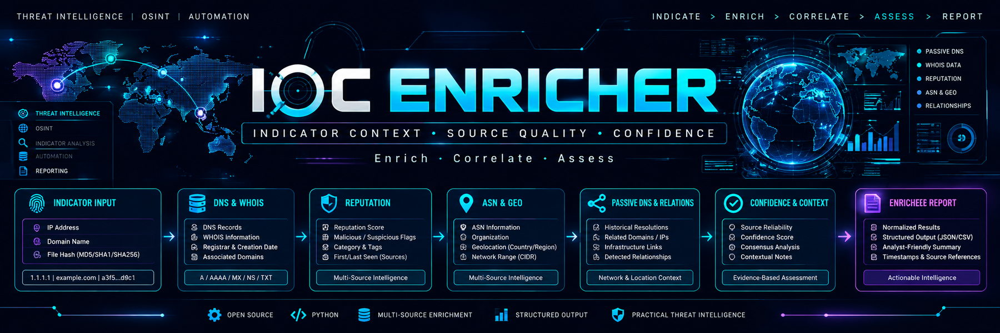
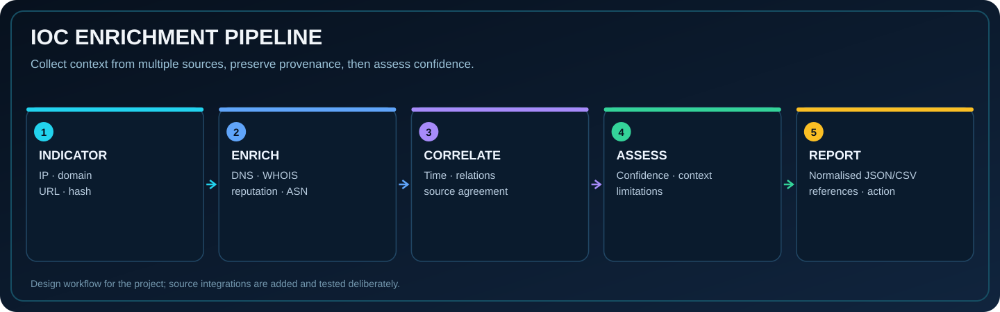

**Enrich · Correlate · Assess**

## 🌐 Purpose

A project workspace for learning how to enrich indicators of compromise (IOCs) with context while preserving the source, observation time, confidence and limitations of each result. Enrichment should make an analyst's decision better—not turn a single weak reputation result into a verdict.

## 📦 Planned indicator types

- IPv4/IPv6 addresses
- Domains and URLs
- File hashes

## 🔬 Enrichment context to record

| Source / field | Why it matters |
|---|---|
| DNS records and passive DNS | Resolution history and relationships |
| WHOIS / registration data | Registration context and age where available |
| Reputation source | What source reported and when |
| ASN / geolocation | Infrastructure context, not proof of maliciousness |
| Related indicators | Correlation and shared infrastructure hypotheses |
| Confidence and provenance | Source reliability, agreement and analyst notes |

## 📂 Project files

- [Enrichment report template](docs/ioc-report-template.md)
- [Synthetic training indicators](data/training-iocs.csv)
- [Pipeline diagram](assets/ioc-enrichment-pipeline.svg)

## 🛡️ Accuracy and safe use

Use documented APIs and respect provider terms, rate limits and privacy requirements. Keep source URLs, query time and raw result references. Distinguish reputation, observation, correlation and attribution. The included CSV uses documentation-reserved domains/IPs and synthetic labels; it does not describe live threat intelligence.

## 🗺️ Suggested build stages

1. Define a typed input/output schema.
2. Add one source adapter at a time with caching and error handling.
3. Normalise results while retaining raw source, time and provenance.
4. Compute confidence transparently rather than relying on a single score.
5. Export analyst-friendly JSON/CSV with references and limitations.
